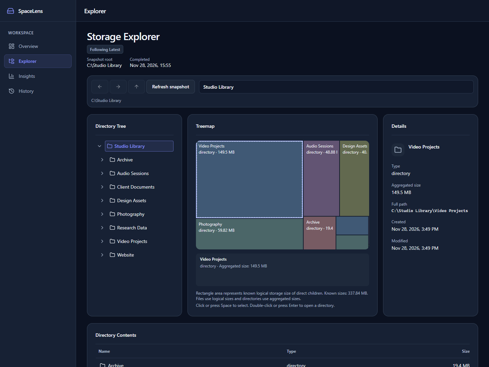
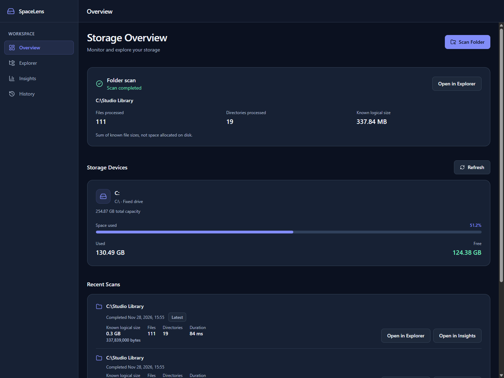
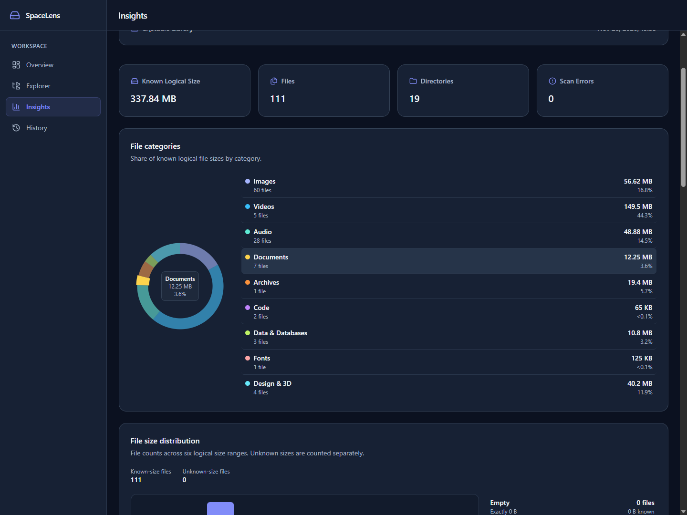
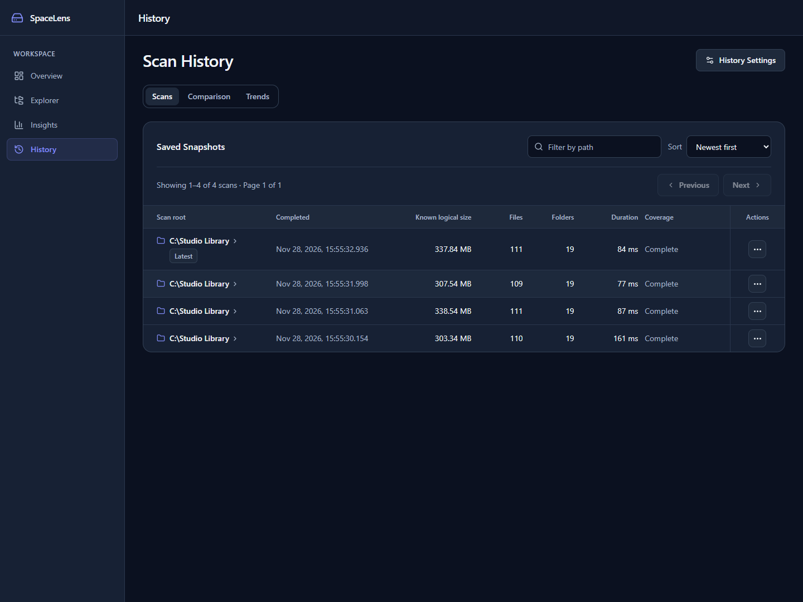
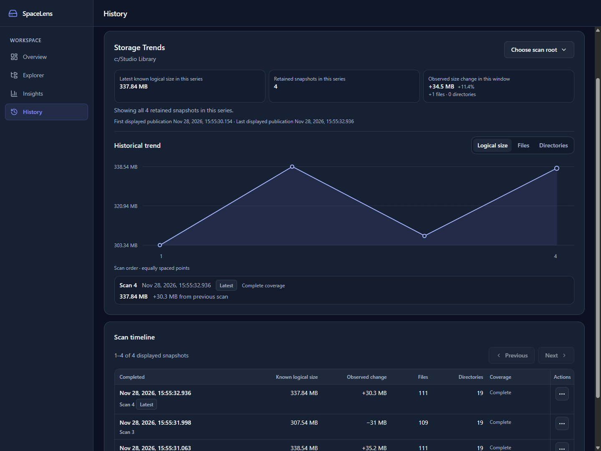
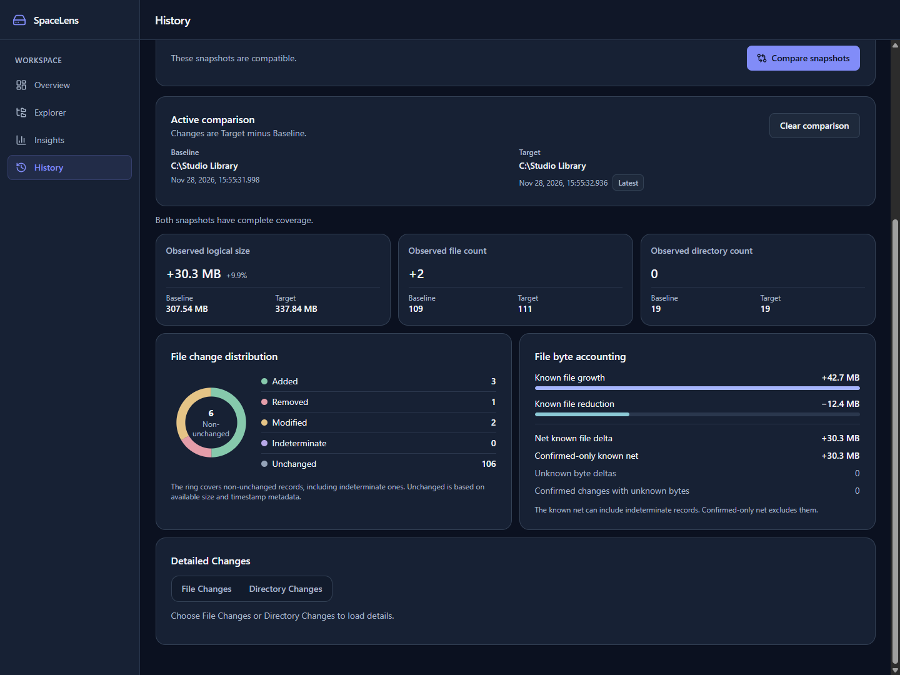
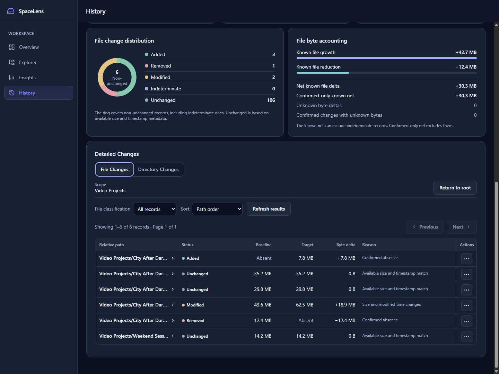

# SpaceLens

**See what takes up space and track how it changes.**

SpaceLens is a desktop app for exploring local storage. Scan a folder to find large files and directories, see how space is used, and compare saved scans over time.



## Features

- **Overview** shows Windows drive capacity, scan progress, and recent results.
- **Explorer** lets you browse current and saved scans with a directory tree, interactive treemap, and file details.
- **Insights** shows your largest files and folders, file types, and size distribution.
- **History** lets you reopen or delete locally saved scans and set how many to keep.
- **Comparison** shows which files were added, removed, or modified and which folders grew or shrank between two scans of the same folder.
- **Trends** charts size, file count, and folder count across compatible scans.

## Screenshots

The screenshots show four scans of the same example studio library.

| Overview                                                                                                   | Insights                                                                                                |
| ---------------------------------------------------------------------------------------------------------- | ------------------------------------------------------------------------------------------------------- |
|  |  |

| Scan History                                                                                                | Storage Trends                                                                                             |
| ----------------------------------------------------------------------------------------------------------- | ---------------------------------------------------------------------------------------------------------- |
|  |  |

| Comparison Summary                                                                                                         | Detailed Changes                                                                                                           |
| -------------------------------------------------------------------------------------------------------------------------- | -------------------------------------------------------------------------------------------------------------------------- |
|  |  |

## Getting started

SpaceLens has been verified on **Windows x64**. Follow [Run locally](#run-locally) through `npm ci`, then run `npm run build:win` on Windows to create the installer.

1. Run `dist/spacelens-0.1.0-setup.exe` and launch **SpaceLens** from the Start menu or desktop shortcut.
2. Select **Scan Folder** on Overview and choose a directory.
3. Open **Explorer** or **Insights** when the scan completes. Scan the same folder again to compare results under **History**.

## Run locally

Use Git, npm, and Node.js **22.22.2 or later in the 22.x line**, or **24.15.0 or later in the 24.x line**.

```sh
git clone https://github.com/byndzieyes/SpaceLens.git
cd SpaceLens
npm ci
npm run dev
```

To preview the production application, build it and then start Electron.

```sh
npm run build
npm start
```

On Windows, build the x64 NSIS installer with this command.

```sh
npm run build:win
```

The production bundles are written to `out/`. The Windows installer is written to `dist/`.

## Technology and architecture

SpaceLens uses Electron, React, and TypeScript, with Tailwind CSS for styling and D3 hierarchy for treemap layout. electron-vite builds the app, and electron-builder packages the Windows installer.

The React interface calls Electron's main process through a typed preload API. A background worker scans folders without changing files. A separate worker handles SQLite, which stores completed scans and serves analysis queries.

## Testing

Vitest and Testing Library cover scanning, snapshot storage, comparison queries, and UI interactions.

```sh
npm test
npm run typecheck
npm run lint
```

## Known limitations

- Windows x64 is the verified platform. The unsigned installer may trigger a Windows security warning. macOS and Linux packages remain unverified.
- Comparison uses file metadata and does not detect renames. Inaccessible files can leave a scan partial and some changes indeterminate.
- Preparing a large comparison can take several seconds. Scanning and comparison preparation run separately.
- Snapshot sizes reflect logical file size. Trends shows up to 100 recent scans per compatible series.
